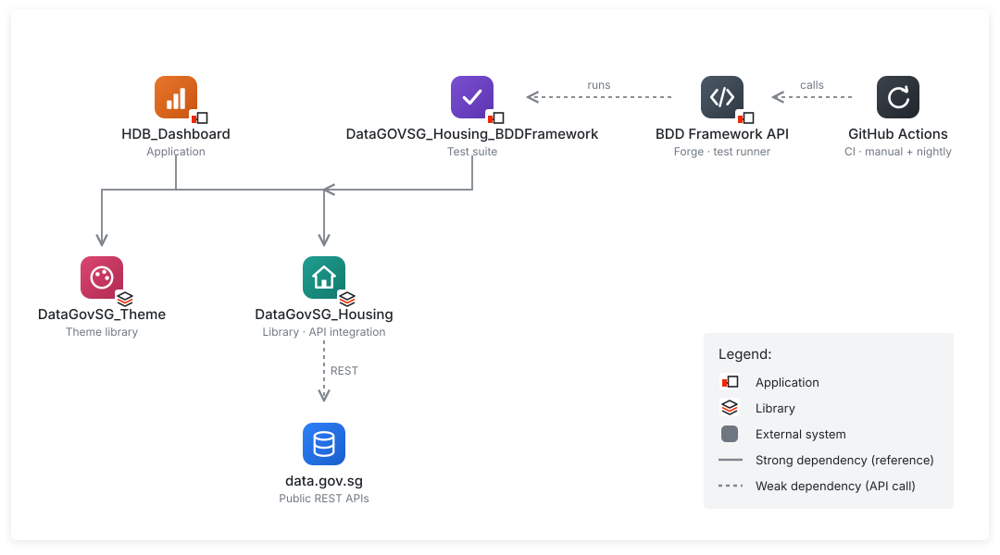
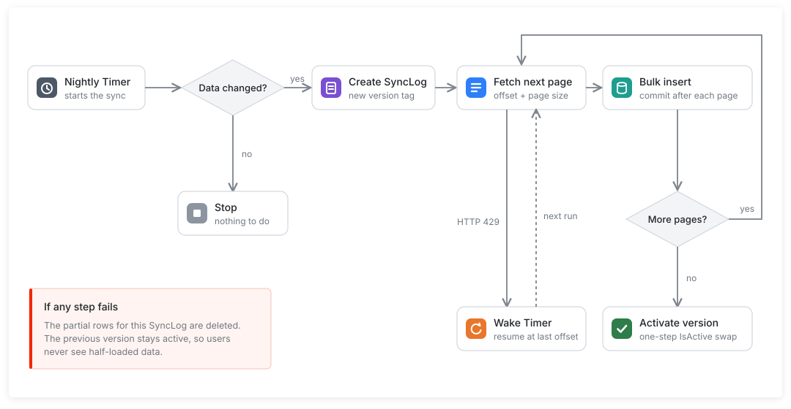

# HDB Resale Explorer
A dashboard for exploring HDB resale flat prices in Singapore, built on OutSystems Developer Cloud (ODC) with public data from [data.gov.sg](https://data.gov.sg).

Live app (no login needed): https://personal-dfwoxjal-dev.outsystems.app/HDB_Dashboard

## Apps

Core
- `HDB_Dashboard` (application): the dashboard itself. It keeps a local copy of the data, runs the nightly sync, and has the filters, KPIs, chart explorer and transactions table.
- `DataGovSG_Housing` (library): wraps the data.gov.sg APIs and tells the caller when it hits the rate limit.

Theme
- `DataGovSG_Theme` (library): a single stylesheet that restyles OutSystems UI. Apps pick up the design by referencing it.

BDD
- `DataGOVSG_Housing_BDDFramework` (test suite): automated tests for the library, run from GitHub Actions.

## Install

The four assets are in the [`oml`](oml) folder. Install them in this order, because each one depends on the ones before it. You'll need ODC Studio connected to your ODC organization.

1. BDD Framework from Forge. In the ODC Portal, open Forge and install [BDD Framework (ODC)](https://www.outsystems.com/forge/component-overview/15745/bdd-framework-odc) and [BDD Framework API (ODC)](https://www.outsystems.com/forge/component-overview/15746/bdd-framework-api-odc).
2. `DataGovSG_Housing.oml`: In ODC Studio, go to Menu > Organization > Open Files, pick the file and click 1-Click Publish. Then release it: in the Portal, go to Apps, filter by Library, open the library and choose Release Library. Apps can't use a library until its first version is released.
3. `DataGovSG_Theme.oml`: same as step 2: open, publish, release.
4. `HDB_Dashboard.oml`: open and publish.
5. `DataGOVSG_Housing_BDDFramework.oml`: open and publish.

If Studio says a dependency is missing when you open a file, install the earlier step first and open the file again.

Opening and exporting .oml files is covered in the [ODC docs](https://github.com/OutSystems/docs-odc/blob/main/src/eap/getting-started/open-oml-in-odc-studio.md), and releasing libraries [here](https://github.com/OutSystems/docs-odc/blob/main/src/eap/building-apps/libraries/libraries.md).

### After installing

In the Portal, under each app's Configuration > Settings:

- `HDB_Dashboard`: add your data.gov.sg API key in the library setting (optional, but it raises the rate limit).
- `DataGOVSG_Housing_BDDFramework`: set `AuthenticationSecretToken` to a long random string.
- `BDDFrameworkAPI`: set its token to the same string.
- GitHub: add the same string as the repository secret `BDD_AUTHTOKEN`, and your ODC domain (for example `https://<your-domain>`) as the repository variable `ODC_BASE_URL`. Both are under Settings > Secrets and variables > Actions.

The token is the same in all three places. If they don't match, the API returns no tests and the workflow fails.

Then load the data. The dashboard is empty after a fresh install, and the sync Timer only runs on its own at night, so run it once by hand: in the Portal, open `HDB_Dashboard`, go to Timers and click Run now on the sync Timer. If the first load pauses on the rate limit, it carries on by itself.

To run the tests by hand, open `https://<your-domain>/DataGOVSG_Housing_BDDFramework/Housing?AuthToken=<token>`.

## Architecture

The API integration and the theme are libraries so other apps can reuse them. The data and the sync live in `HDB_Dashboard` because in ODC only apps can store data. The tests are in a separate app, which is how the BDD Framework suggests testing a library ([docs](https://www.outsystems.com/forge/component-documentation/15745/bdd-framework-odc/0)).

## Data sync

The dashboard doesn't query data.gov.sg live. It reads a local copy of the [HDB resale dataset](https://data.gov.sg/datasets/d_8b84c4ee58e3cfc0ece0d773c8ca6abc/view), about 243,000 rows, which a Timer refreshes every night by pulling the data one page at a time.

### Why pages instead of downloading the file

data.gov.sg does offer a [download API](https://guide.data.gov.sg/developer-guide/dataset-apis/download-dataset), but it hands back the whole dataset as one file, and it has a lower [rate limit](https://guide.data.gov.sg/developer-guide/api-overview/api-rate-limits) than the Datastore Search API (2/4/10 calls per 10 seconds versus 4/8/20, depending on the API key).

Importing one large file also doesn't fit ODC well. A Timer can run for at most 60 minutes and custom code payloads are capped at 5.5 MB ([platform limits](https://github.com/OutSystems/docs-odc/blob/main/src/eap/getting-started/system-requirements.md)). A Timer that times out is retried up to three times, so the logic has to be safe to run again ([Timers](https://github.com/OutSystems/docs-odc/blob/main/src/eap/building-apps/timers/intro.md)). OutSystems' own guidance for large jobs is to work in small committed chunks and use the wake timer pattern ([batch integration](https://github.com/OutSystems/docs-odc/blob/main/src/eap/building-apps/data/data-best-practices/batch-integration/intro.md), [long-running Timers](https://github.com/OutSystems/docs-odc/blob/main/src/eap/monitor-and-troubleshoot/manage-technical-debt/performance/avoid-long-running-timers.md)).

Paging gives us that. Each page is committed on its own, so if anything stops the sync it picks up where it left off.

### How it works

1. Read the dataset's `lastUpdatedAt`. If nothing changed since the last sync, stop.
2. Fetch a page, bulk insert it, commit, and move to the next one.
3. If the API returns 429, wake the Timer and continue from the last page.
4. Once every row is in, switch the new version on in one step.
5. If the sync fails, delete the partial rows. The previous version stays live, so users never see half the data.

## Tests

`DataGOVSG_Housing_BDDFramework` tests the library against the live API:

- LIB-01: a search with limit 10 returns 10 records and a total above 0
- LIB-02: the dataset metadata returns a `lastUpdatedAt` that isn't in the future
- LIB-03: searching with an invalid resource ID returns a handled error

GitHub Actions runs the suite through the [BDD Framework API](https://www.outsystems.com/forge/component-documentation/15746/bdd-framework-api-odc/0), on demand after publishing and every night at 02:00 MYT. The run fails if any scenario fails. The test token is stored as a GitHub secret and never printed. See [`.github/workflows/bdd-tests.yml`](.github/workflows/bdd-tests.yml).
